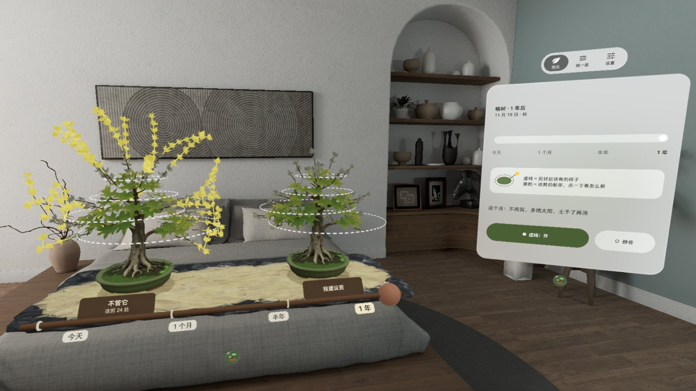
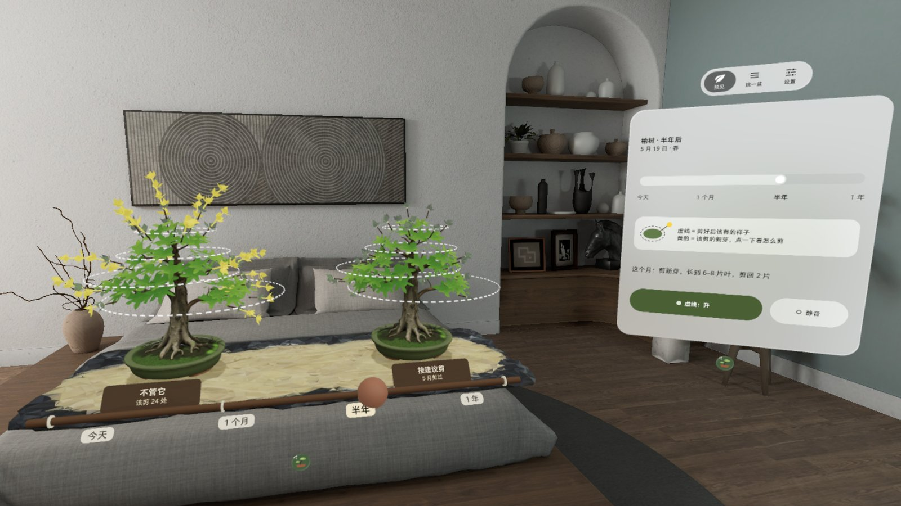
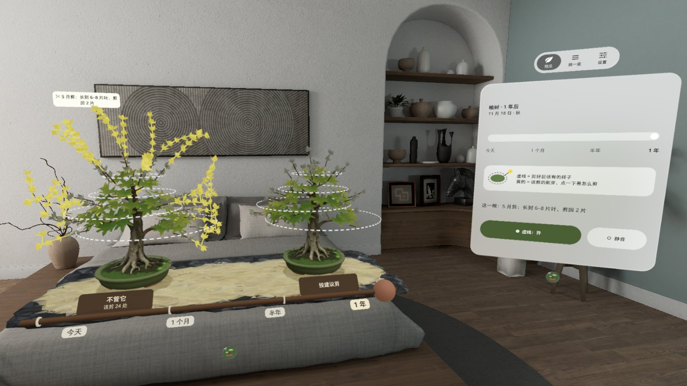
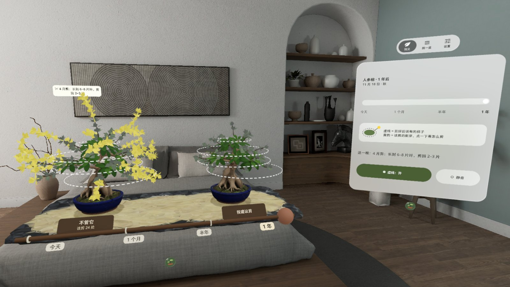
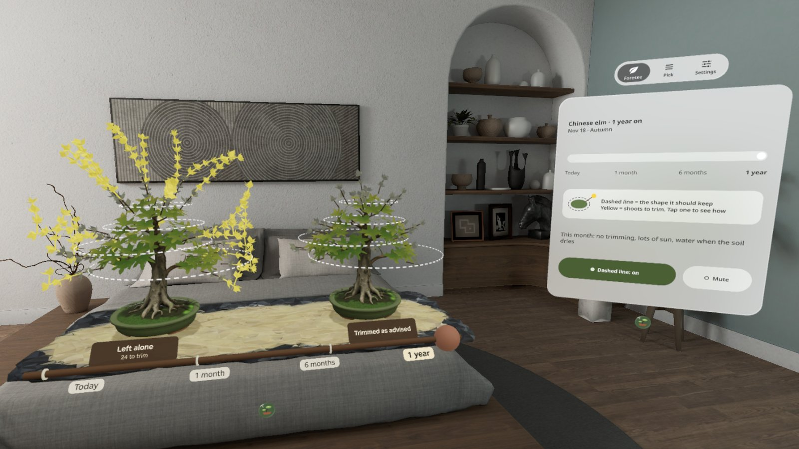

# 盆景预见 · Bonsai Ahead


**中文** · [English](#english)

挑一盆，拖一下时间，看它一年后长成什么样；不剪和按时剪，左右一比就懂。

PICO OS 6 共享空间里的一盆真实盆景（Tripo 生成的 5 种树：五针松、真柏、榆树、雀梅、人参榕），左右两盆同一棵树：左边「不管它」，右边「按建议剪」。拖时间条从「今天」到 1 个月 / 半年 / 1 年，两盆一起长、跟着季节变色落叶；左边会冒出黄色的「该剪了」新梢，点一根就告诉你这个月怎么剪。控制窗有「预见 / 挑一盆 / 设置 / 怎么操作」，中英双语，不联网、不要账号。



| 半年后 | 点黄梢看剪法（榆树） | 点黄梢看剪法（人参榕） |
|---|---|---|
|  |  |  |

截图和演示视频都在 PICO 模拟器里拍，用调试广播驱动，**非真实手势录像**。

### 安装

从 [Release v0.2.2](https://github.com/kejing-dev/BonsaiAhead/releases/tag/v0.2.2) 下载 `BonsaiAhead-v0.2.2.apk`（assembleRelease 未签名包，供平台托管签名），或自己用 debug key 签名后：

```bash
adb install -r BonsaiAhead-v0.2.2.apk
pico-cli app launch io.embodit.bonsai
```

---

<a id="english"></a>
## English

Pick a bonsai, drag time, and see what it looks like a year from now: left alone vs trimmed as advised, side by side.

A real bonsai (five Tripo-generated species: Japanese white pine, Chinese juniper, Chinese elm, Sageretia, Ginseng ficus) stands twice in a PICO OS 6 Shared Space volume: the left one is **left alone**, the right one is **trimmed as advised**. Drag the time bar from Today to 1 month, 6 months or 1 year; both grow and change with the seasons, and the left one sprouts yellow "to trim" shoots. Tap one to see how to trim it this month. The control window has Foresee / Pick / Settings / How to. Chinese and English, offline, no account.




Screenshots and the demo video were captured in the PICO emulator, driven by debug broadcasts: **not a real hand-gesture recording**.

### Install

Download `BonsaiAhead-v0.2.2.apk` from [Release v0.2.2](https://github.com/kejing-dev/BonsaiAhead/releases/tag/v0.2.2) (unsigned assembleRelease build for platform signing; sign it with a debug key for side-loading), then:

```bash
adb install -r BonsaiAhead-v0.2.2.apk
pico-cli app launch io.embodit.bonsai
```

---

## Developer notes

A bonsai foresight tool in a PICO OS 6 Shared Space volume (Spatial SDK BOM 6.1.9), package `io.embodit.bonsai`, v0.2.2.
Design contract: spatial-app-factory `apps/bonsai/design-package.json` (v3.0, gate B 2026-11-19: name 盆景预见 · Bonsai
Ahead, tag on day 0 says just 今天 / Today, other questions default). Two copies of the same real bonsai (Tripo Smart
Mesh pick) stand side by side: left **left alone**, right **trimmed as advised**; drag time from today to 1 month,
6 months, 1 year and see both grow, change with the seasons and, on the left, grow yellow "to trim" shoots.

v0.1.0 (cut / water / score / shelf, the procedural "green lumps") is gone; its history stays in git.

## Surfaces
- **Volume** (default container `BonsaiAheadPot`, Volumetric 1.3 x 0.85 x 0.7 m, fixed scale, gravity aligned, base panel
  hidden). Actual metres everywhere (no design units). Stone slab (Tripo tray-B stretched), two pots at x ±0.32, the 3D
  time bar (wooden rail, draggable bead, four tap stops), pot tags, the stop strip and the tip label (AttachmentPanels).
- **Control window** (`BonsaiAheadControl`, Planar 520 x 600 dp, `Placement.right(pot)`): native TabBar
  预见 / 挑一盆 / 设置 (+ 怎么操作). The time slider is the main control (0..1 with the four stops evenly spaced).

## Code
| Path | What |
|---|---|
| `domain/Species.kt` | the 5 species: monthly growth, prune months / rule, leaf drop, tint, height |
| `domain/Growth.kt` | pure growth model (left alone / trimmed / highlight / recent cut), time bar mapping, `ShootPath` node layout + envelope |
| `domain/Foresee.kt` | the single state source (D38): scrub / release / stops / turn / tip / pick / guide, settings, persistence |
| `domain/ShootMesh.kt` | organic polygon leaf clusters, stems, dashed rings, cut caps (CPU meshes) |
| `domain/MetaJson.kt` | reads `assets/trees/<file>/meta.json` (also in JVM tests) |
| `ui/scene/ForeseeScene.kt` | entities: species kits (Tripo wood + 4 baked leaf variants) cached + toGlobal (D59), pooled shoot entities |
| `ui/scene/VolumeScreen.kt` | SpatialView, attachments, board-input routing (bead drag, ticks, pot tap / drag, yellow shoots) |
| `ui/control/ControlWindow.kt` | the window pages; pad keys eaten, buttons unfocusable (D60) |
| `platform/BackKeys.kt` | BACK / controller B at the earliest layer of every window (copied from circuit-lab v0.1.3) |
| `tools/prepare_trees.py` | Tripo GLB -> wood.glb + leaf_<sp/su/au/wi>.glb + meta.json (split by texture colour, anchors, rings) |
| `tools/glb_jpeg.py` | re-encodes GLB textures as 1024 JPEG |
| `tools/import_sounds.py`, `tools/loudness.py`, `tools/build_icon.py` | CC0 cuts, loudness evidence, icon |

## Assets
`~/.factory-venv/bin/python tools/prepare_trees.py ~/Downloads/bonsai-tripo/smart/textured` then
`for f in app/src/main/assets/trees/*/*.glb; do ~/.factory-venv/bin/python -I tools/glb_jpeg.py $f $f 1024; done`.
Picks and reasons: spatial-app-factory `apps/bonsai/design/tripo-picks/`.

## Build / test (kj-mbp-m5)
```bash
export JAVA_HOME=~/.pico/primer-cli/jdk/jdk-21.0.13+9/Contents/Home
./gradlew assembleDebug :app:testDebugUnitTest
```
Offline release: add `-x lintVitalAnalyzeRelease -x lintVitalReportRelease -x lintVitalRelease` if lint is not cached.

## Debug broadcast (QA screenshots)
`adb shell am broadcast -a io.embodit.bonsai.DEBUG -p io.embodit.bonsai --es cmd <cmd> --es a "<arg>"`, log tag
`BonsaiAhead`. Every input command goes through the same Foresee calls as a real slider / pinch / button.
`reset` = fresh install (T0 2026-11-18 unless `a` gives another date, elm, day 0, guide on); start every shot with it.

| State | Commands (in order) |
|---|---|
| S00 | `s00hold on`, force-stop + launch, shoot within 10 s, `s00hold off` |
| S01g guide | `reset`, force-stop + launch (step 1); `day 30` (step 2) |
| S01 / S03 / S04 / S05 | `reset` → `noguide` → `species <wuzhensong / zhenbai / yushu / quemei / renshenrong>` → `day 0 / 30 / 182 / 365` (or `stop 0..3`) |
| S02 scrubbing | `scrub 100` (no release) |
| S06 tip | S05 → `tapyellow` (first yellow shoot) |
| S06w winter bare | `species yushu` → `day 30` |
| S07 pick | `page pick` |
| S08 / S08h / S09 | `page settings` · `page howto` · `confirm on` |
| S10 window closed | `closepanel` (strip shows [打开面板]) · `openpanel` |
| turn / dashed / lang | `turn` · `yaw 90` · `dashed off` · `lang en` |
| D59 | `stress 20` (scrub 0 ↔ 365 + pick every species, 20 rounds) |
| other | `back` · `dump` |
